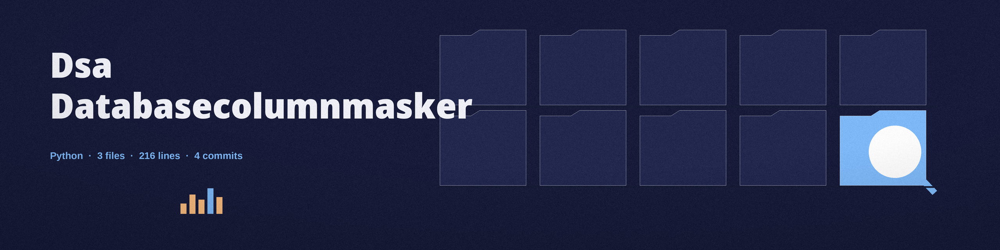

# dsa-DatabaseColumnMasker
Connects to a SQLite database and applies a chosen masking function (e.g., redaction, hashing, partial masking) to specified columns. Provides a command-line interface for specifying the database file, table name, column names, and masking function. Uses the sqlite3 module. - Focused on Tools focused on masking or removing sensitive information from datasets, logs, and other potentially exposed data. Allows for safe data sharing for testing, development, or analysis without revealing private or confidential information. Utilizes techniques like data substitution, redaction, and generalization.

## Install
`git clone https://github.com/ShadowStrikeHQ/dsa-databasecolumnmasker`

## Usage
`./dsa-databasecolumnmasker [params]`

## Parameters
- `-h`: Show help message and exit
- `--masking_function`: No description provided
- `--partial_mask_percentage`: Percentage of characters to mask in partial masking. Only applicable when using 

## License
Copyright (c) ShadowStrikeHQ

## Notes
- Before the first update, the tool writes a timestamped backup copy of the database file beside it and prints its path. If the backup copy cannot be written, the run is refused at exit 1 and the database is not changed.
- The tool prints how many rows were masked in each column. A run that masks zero rows in every named column, for example over an empty table, exits 1 and does not report a completed masking.
